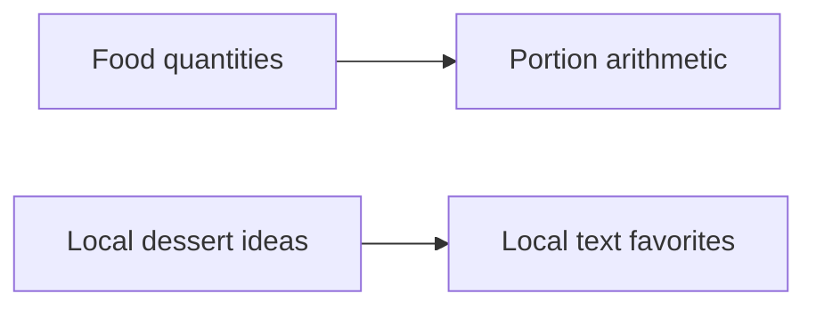

# Aylina Is Cooking — carnet culinaire

**Local portion arithmetic · Recipe ideas · Local favorites**

## État actuel — correction P0

Le [commit source](https://github.com/Nikoju1977/aylina-is-cooking/commit/c25e48bdf50a7f6b8eb6e9f7879b363a3d80e3e0) retire les entrées et sorties de calcul d'insuline. Les glucides par portion sont calculés sur des quantités finies non négatives et un nombre entier positif de portions. Les résultats sont invalidés à la modification des entrées. Le chef IA distant et la dictée sont suspendus ; aucun nouvel appel Mistral ni profil d'enfant n'est proposé. Les favoris existants sont affichés comme texte non fiable, non comme HTML ; suppression volontaire de l'ancien profil et de sa clé disponible.

Les favoris peuvent rester en stockage local non chiffré. Les anciennes données de profil ne sont pas automatiquement effacées. Ne pas saisir de données sensibles. Vérifier les recettes, ingrédients et allergènes. Aucun test fonctionnel, médical ou déploiement nouveau.

## English overview

Local culinary portion arithmetic and dessert ideas. Insulin calculations have been removed, remote AI and dictation paused, and favorites rendered as text. Legacy profile removal is voluntary. No new runtime validation.

[Notice de droits](LICENSE.md).

## Historique

Les constats antérieurs sont conservés dans l'historique Git du README. Les licences existantes restent inchangées.
