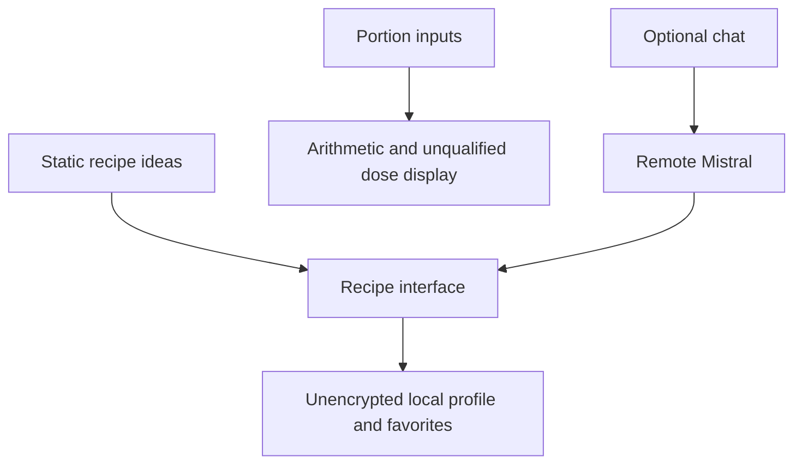

# 🍳 Aylina Is Cooking

> **Avertissement P0 :** le code affiche une estimation de dose d'insuline non validée. Ne jamais l'utiliser pour un traitement, notamment chez un enfant. Ne pas saisir de données personnelles ni de clé réelle.

## Architecture constatée

Dans [index.html](index.html), renderRec affiche quatre idées statiques, doCalc calcule les portions et une estimation thérapeutique non qualifiée, sendMsg transmet l'historique et du contexte de profil à Mistral. Le profil et la clé sont conservés via safeStorage sans chiffrement applicatif établi. Le rendu HTML de contenus non fiables nécessite également une revue de sécurité.

Priorités proposées : retirer le calcul de dose, conserver des calculs alimentaires non thérapeutiques, vérifier quantités et allergènes, sécuriser le rendu et éviter la transmission de données d'enfants. Aucun correctif applicatif, test, appel distant ou validation clinique effectué.

## English overview

Experimental culinary interface with static recipe ideas, portion arithmetic, optional Mistral assistance and local favorites. An unqualified insulin-dose display and unencrypted profile storage require correction. Do not use for treatment decisions or enter real children's information or API credentials. No new runtime or clinical validation.

[Notice de droits](LICENSE.md) : droits réservés, droits tiers préservés.

## Ce que fait l'application, en pratique

**Aylina Cookies** est un carnet culinaire interactif orienté desserts : recettes comme les cookies à indice glycémique bas et les gâteaux, **calculateur de portions**, espace « Chef Mistral », vitrine et favoris. L'utilisateur explore des idées de recettes et peut préparer ses préférences depuis le navigateur.

**Statut :** prototype culinaire. Les conseils liés au diabète, à une hypoglycémie, aux glucides ou aux allergies doivent être vérifiés auprès de sources fiables ; le logiciel affiche une estimation de dose non validée, à ne jamais utiliser pour un traitement.

**Studio Niko Design** — Application culinaire IA personnalisée.

## 🛠 Stack
`HTML` · `Mistral AI`

## 👤 Auteur
**Nicolas Julienne** — [Studio Niko Design](https://github.com/Nikoju1977)
📧 nicolasjulienne.nj@gmail.com

---

## Utilisation, périmètre et maturité

**Thème :** Application culinaire — prototype IA.

L'interface est fournie sous forme de page web (`index.html`) avec manifeste et icône. On peut l'examiner localement avec `python3 -m http.server 8000`. Les fonctions d'IA décrites ci-dessus peuvent nécessiter une connexion ou un service tiers.

**Limites :** démonstration créative ; vérifier recettes, quantités, températures de cuisson et allergènes auprès de sources fiables. Ne pas inclure de secrets API dans le dépôt public.

**État de validation :** documentation actualisée à partir de la structure du dépôt ; aucun test d'exécution, contrôle de sécurité ou audit réglementaire n'est revendiqué.

[Voir les autres projets Studio Niko Design](https://github.com/Nikoju1977).
